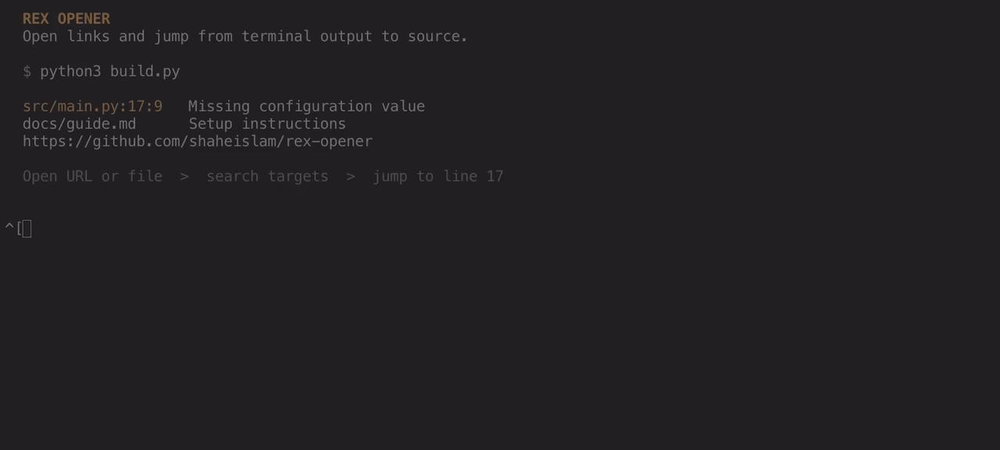

# Rex opener

Open URLs and local files straight from a [Rex](https://www.superlogical.com/rex)
terminal's output. Use it to follow a link, jump to a file mentioned in a build
error, or browse a directory without copying its path.

The plugin registers **Open URL or file** (`rex_opener_open`). You choose the
shortcut; it does not install any keybindings.

## Demo



Recorded in Rex with sample build output: open the picker, search for `main.py`,
and jump to the reported line in Neovim. Cropped close-ups keep the targets and
source readable; the demo uses the real opener with automated input.

## What it opens

| Target | Result |
| --- | --- |
| URLs and bare domains | Your default browser via macOS `open` |
| Text and Markdown files | A new Neovim split, at the line in `file:line:column` when present |
| Directories | Yazi in a picker terminal |
| Videos | IINA if installed, otherwise the default application |
| Other existing files | Their default macOS application |

One detected target opens immediately. With multiple targets, an fzf picker lets
you search and choose; press **Enter** to open or **Escape** to cancel. The parser
handles Markdown links, paths containing spaces, and surrounding punctuation.

## Requirements

- **macOS with a local Rex server.** Tested with Rex CLI
  `0.0.1792787366-g623b2d`; Beta APIs may change.
- **Python 3.10+, Bash, Perl, Fish, and fzf.** No Python packages or plugin manager
  are needed.
- **Neovim** for text files and editor-hosted pickers; **Yazi** for directories.
  IINA is optional.
- **Rex CLI on the server's `PATH`**, or `REX_BIN_DIR` pointing to its directory.
- Enable **Settings → Rex Server → Remote Control** for targeted app focus.

## Quick start

Clone the plugin to a permanent location:

```fish
git clone https://github.com/shaheislam/rex-opener.git ~/.config/rex/plugins/rex-opener
```

Add this to `~/.config/rex/init.lua` (or your `REX_CONFIG` file):

```lua
dofile(os.getenv("HOME") .. "/.config/rex/plugins/rex-opener/init.lua")()
rex.bind("ctrl+s>o", "rex_opener_open")
```

**Check and reload the configuration before trying the shortcut:**

```fish
rex config check
rex --autostart=false config reload
```

Press **Ctrl-s, then o** in the terminal whose output you want to use. You can
also run **Open URL or file** from Rex's command palette.

### Choose a different shortcut

Replace the `rex.bind` line with your preferred Rex key or leader sequence:

```lua
rex.bind("cmd+shift+o", "rex_opener_open")
```

Omit it entirely if you only want the command-palette action.

### Make tools available to the GUI server

Rex launched as a macOS app may not inherit your shell's `PATH`. If the server
cannot find your tools, pass a complete path when loading the plugin:

```lua
dofile(os.getenv("HOME") .. "/.config/rex/plugins/rex-opener/init.lua")({
  path = "/opt/homebrew/bin:/usr/local/bin:/usr/bin:/bin:/usr/sbin:/sbin",
})
rex.bind("ctrl+s>o", "rex_opener_open")
```

Adjust that list to include the directories containing **Rex, Python, Fish, fzf,
Neovim, and Yazi**, then check and reload again. See [INSTALL.md](INSTALL.md) for
the full installation and picker-placement details.

## Troubleshooting

**The shortcut does nothing after installation or an update**

Run `rex config check`, fix any reported errors, then run
`rex --autostart=false config reload`. An already-running server can still have
the old configuration loaded. Check that `rex actions` lists `rex_opener_open`
and `rex keymap` lists your chosen binding. If the palette action works but the
shortcut does not, check for a conflicting shortcut in your Rex configuration.

**A tool works in your shell but not in the opener**

Check the GUI server's tool path using the explicit `path` option above. Your
interactive shell finding a command does not mean the server can find it.

**No URL or file is found**

Run the action in the terminal containing the output. Local paths must exist and
relative paths are resolved against that terminal's working directory. The
terminal must report a usable working directory.

## Scope and limitations

- Reads the invoking terminal's output and scrollback; it does not prioritize
  links in the visible viewport.
- Supports local panes owned by the current user. Remote-server panes and other
  users' terminals are rejected.
- Text targets open in a new editor split. Only the line number, not the column,
  is passed to Neovim.
- Pickers use the invoking Neovim's floating terminal when possible, otherwise a
  Rex layer. A session shared with another app uses a temporary private picker
  session to avoid redirecting that app.

## Development

Run the standalone checks from the cloned repository:

```fish
python3 test_opener.py
```

The tests copy the plugin into a temporary directory and check parsing,
scrollback capture, dispatch, ownership checks, and configurable bindings.
Neovim is required for the Lua registration test. These checks do not exercise
physical keyboard input or your desktop's default applications.
